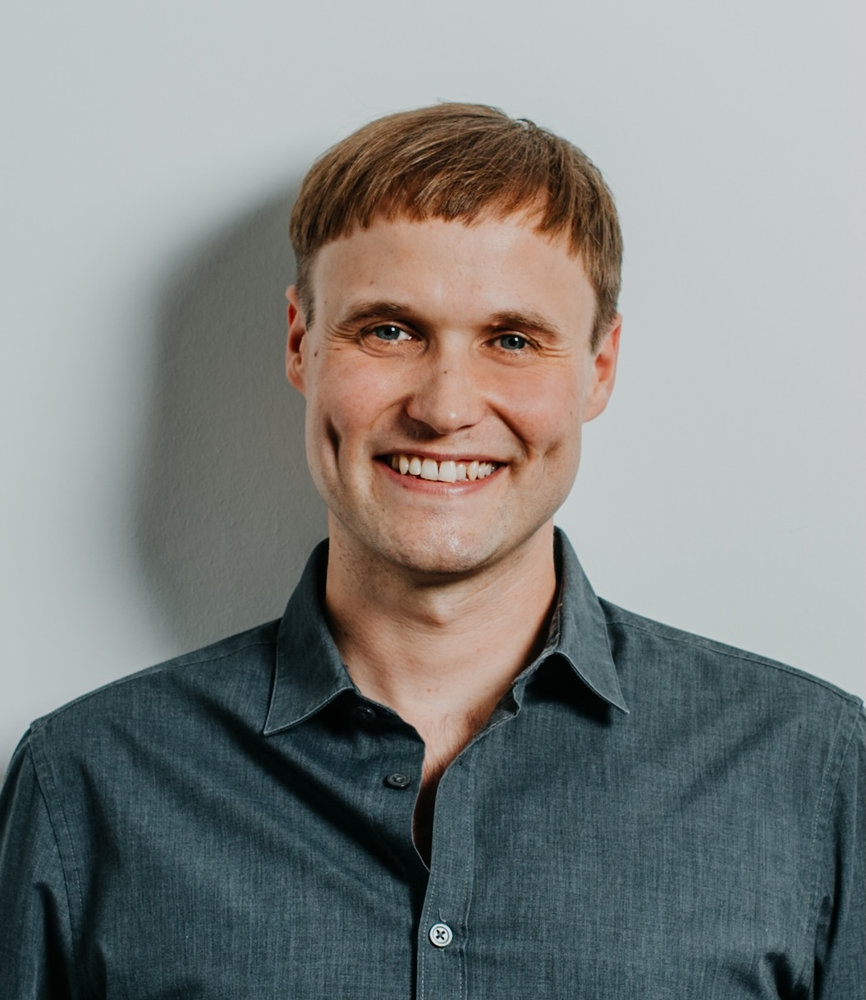

# Markus Gödker

Researcher

Faculty of Psychology & Education

[m.goedker@lmu.de](mailto:m.goedker@lmu.de)

[LMU Profile](https://www.lmu.de/psy/en/persons/contact-page/markus-goedker-f7680f7a.html)

## Mission Statement

In my own research, I implement practices such as preregistration and Open Access publishing. Open and FAIR data is essential for me, particularly for my current work with meta-analyses. I believe that the Open Science community can extend more towards Open and FAIR theory building. I am interested in advancing infrastructures and practices that make theories, definitions, and hypotheses more transparent, reusable, and interoperable.
