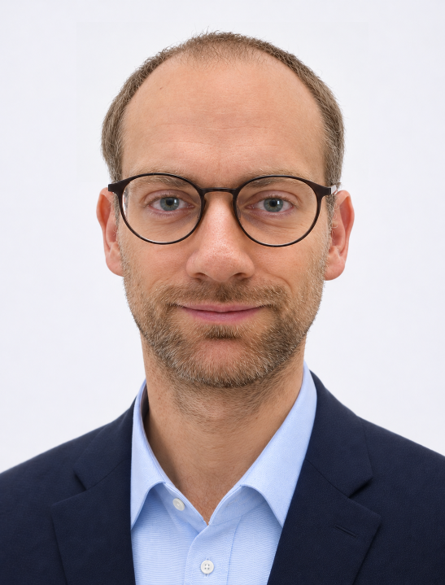

# Tobias Niedermaier

Postdoctoral Researcher

Faculty of Medicine

[tobias.niedermaier@ibe.med.uni-muenchen.de](mailto:tobias.niedermaier@ibe.med.uni-muenchen.de)

[LMU Profile](https://www.med.lmu.de/ibe/de/personenverzeichnis/kontaktseite/tobias-niedermaier-cc0a2973.html)

## Mission Statement

I am a postdoctoral researcher at the Institute for Medical Information Processing, Biometry, and Epidemiology (IBE). Despite progress in research transparency, reproducibility remains a major challenge. Researchers may hesitate to share code and data due to the additional effort or concerns about others benefiting from their work. Yet preparing research for sharing encourages clear documentation, benefiting both the scientific community and our future selves. I therefore strongly support the Open Science Center’s efforts to address these concerns and promote reproducible research through practical training.
